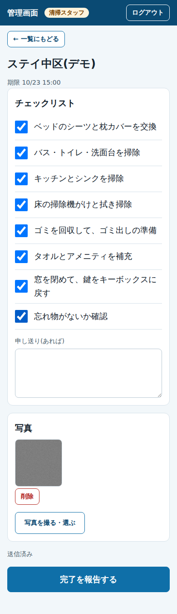

# 民泊管理デモアプリ(広島・架空物件)

広島市中区の**架空のマンション一室**を想定した、民泊の宿泊者ガイド・管理アプリのデモです。
住宅宿泊管理業の営業資料と、開発の業務委託向けポートフォリオを兼ねています。

> 物件・人物・番号・連絡先はすべて架空です。実在するのは、平和記念公園や宮島などの公共の観光地のみです。

## いまの段階

**第4段階:AI問い合わせ**(第1〜第3段階は公開済み)

- 宿泊者がガイドの「質問」から聞くと、その物件の**公開ガイドの内容だけ**をもとに、AIが質問と同じ言語(日本語・英語・韓国語など)で答える
- AIの提供元は、環境変数1つで切り替えられる。既定は **Cloudflare Workers AI のオープンなモデル(Gemma 4 26B A4B)** で、無料枠の中で動く。**Claude Haiku 5.5** にも切り替えられる。記録には答えたモデル名が残るので、答えの質を比べられる
- ガイドにないことは推測せず、緊急連絡先を案内する。火事・けが・事故などの言葉には、AIを待たずにすぐ119・110と緊急連絡先を返す
- 上限は、1日50回(全体)と、1つの端末から1時間に10回。Workers AIは無料枠(1日10,000 Neurons)の範囲で、Claudeに切り替えるときは Claude Console で月の上限額(5ドル)も設定する
- 質問と回答は管理画面の「問い合わせ」に残り、「答えられなかった質問」をガイドの改善に使う(90日で自動削除)

**第3段階:清掃・スタッフ用PWA・滞在コード**

- **滞在コード**: 宿泊者ガイドの鍵とWi-Fiは、予約ごとの滞在コードを入れた人にだけ表示する。照合はサーバー側の関数(Cloudflare Pages Functions)で行い、正しいコードの一覧は画面に一切渡さない

- 管理者が予約(架空)のチェックアウト日を登録すると、その日の**清掃タスクが自動でできる**(期限は日本時間のチェックイン時刻)
- 清掃スタッフは、スマホのPWAで「今日の清掃」を開き、**チェックリスト・写真・完了報告**を行う
- 管理者・オーナーは、清掃の状況(未完了・期限超過・完了写真)を見られる
- **閲覧専用のデモ用アカウント**で、営業先や業務委託の相手が、変更はできない状態で実際に触れる
- 電波が弱い現場のために、**画面の枠のキャッシュ**と**入力途中の端末保存**に対応(電波が戻ると自動で送る)
- 管理者は、清掃を「最初からやり直す」(チェック・写真・申し送りを消す)ことも、「未完了に戻す」(チェック・写真は残す)こともできる
- 第2段階: Supabase化と管理画面 / 第1段階: 宿泊者ガイド(日本語・英語)
- LINE通知は、検討のうえ採用しなかった(清掃の完了は、管理者とオーナーが画面で確認する)



## 技術と選んだ理由

| 技術 | 役割 | 理由 |
|---|---|---|
| Astro | 宿泊者ガイド | 文章中心のページを軽く速く作れる。静的な内容を先に出し、あとから最新に差し替える |
| React + Vite(PWA) | 管理画面・スタッフ画面 | 入力と一覧の操作が多い画面に向く。ホーム画面に追加して使える |
| Supabase | データ・ログイン・写真 | 行単位の権限(RLS)で、立場ごとに見せる範囲を分けられる |
| Cloudflare Pages | 公開 | 無料枠で、ガイドと管理画面を別々に公開できる |
| Cloudflare Pages Functions | 滞在コードの照合・AI問い合わせ | 鍵(Supabaseの secret key、AIのAPIキー)を画面に出さずに、サーバー側で処理できる |
| Cloudflare Workers AI(Gemma 4 26B A4B) | AI問い合わせ(既定) | 多言語に強いオープンなモデル。APIキー不要で、1日50回なら無料枠(1回約57 Neuronsの見積もり)に収まる |
| Claude Haiku 5.5 | AI問い合わせ(切り替え用) | 日本語と指示の守り方が強い。1回約0.0007ドルの見積もり。前払いの残高が必要 |

清掃スタッフ用を、PWAにするかFlutterにするかは比べて決めました。
必要な機能(カメラ・チェックリスト・送信)はPWAで足り、URLを送るだけで使ってもらえるため、PWAにしています(iPhoneのPWAが苦手な通知は、使わない設計です)。
実運用で、通知や裏での処理が足りなくなったり、BluetoothやNFCの機器と連携したくなったりしたら、データ(Supabase)はそのままで画面だけFlutterに作り替えられます。

## 権限(RLS)

| 立場 | 読める | 書ける |
|---|---|---|
| 宿泊者(未ログイン) | 公開中の物件と、公開中かつ滞在コード不要の項目。鍵・Wi-Fiは、関数で滞在コードを照合したときだけ | なし(AIへの質問は関数経由で、上限つき) |
| admin | すべて | すべて |
| viewer(閲覧専用) | すべて(問い合わせの記録を含む。スタッフのメールは除く) | なし |
| owner | 自分の物件の清掃の状況と写真、問い合わせの記録 | なし |
| staff | 自分の担当の清掃と、その写真 | 担当の清掃の「チェックの完了印・写真・状態・申し送り」だけ |

- 全テーブルでRLSを有効にしています。画面に置くのは、公開してよい Publishable key(または従来の anon key)だけです。
- スタッフが変えてよい項目の制限と、完了の条件(チェックが全部ついている・写真が1枚以上)は、**データベース側のトリガー**で守ります。画面を通さず直接APIをたたいても、守られます。
- 写真は非公開のバケットに置き、期限つきのURLで見せます。保存先は「タスクのID/ファイル名」で、タスクの担当者・オーナー・admin・viewerだけが読めます。
- 写真は、端末側で長辺1600pxまで縮めてから送ります(保存容量と通信量を減らす)。

## 滞在コードのしくみ

1. 宿泊者がチェックイン案内で滞在コードを入れると、ガイドは `/api/stay-code`(Cloudflare Pages Functions)に送る。
2. 関数は、Supabaseのデータベース関数 `verify_stay_code` を **secret key** で呼ぶ。この関数は secret key でしか呼べない(未ログイン・ログイン済みの利用者からは呼べない)。
3. データベース関数が、コードと有効期限(**チェックアウト日まで**)を照合し、正しければ「滞在コードが必要」な項目(鍵・Wi-Fi)だけを返す。
4. 同じ接続元で15分以内に10回まちがえると、しばらく受け付けない(総当たりの防止)。照合の記録は、画面からは読めない。
5. 入れたコードは宿泊者の端末に覚え、次からは自動で表示する。期限が切れたら、端末のコードも消す。

- 鍵とWi-Fiの値は、ページのHTMLやJSに最初から含めない(ビルド時の静的な表示からも外す)。
- 物件ごとに、期限のない**デモ用の滞在コード**を1つ設定できる(デモ物件は `DEMO-2026`)。営業やデモで、鍵の表示を試してもらうためのもので、空にすると使えなくなる。


## AI問い合わせのしくみ

1. 宿泊者が「質問」ページで質問すると、ガイドは `/api/ask`(Cloudflare Pages Functions)に送る。
2. 関数は、緊急の言葉(火事・けが・事故など。日本語・英語・韓国語)があれば、AIを呼ばずにすぐ119・110と緊急連絡先を返す。
3. それ以外は、Supabaseのデータベース関数 `begin_ai_call` で上限を確認して回数を数える。同時に、AIに渡す**公開ガイドの情報**を受け取る(鍵・Wi-Fiなど滞在コードの裏の情報は含めない)。
4. 案内係としてのルール(ガイドの内容だけで答える・同じ言語で答える・わからないことは推測しない・緊急は119/110を最優先)と一緒に、AIに問い合わせる。
   - `AI_PROVIDER` が `workers-ai`(既定)なら、Workers AI の結び付け `AI` で、`AI_MODEL`(既定は `@cf/google/gemma-4-26b-a4b-it`)を呼ぶ。考える過程(`<think>…</think>`)が混ざって返ってきたら取り除く。
   - `AI_PROVIDER` が `claude` なら、`ANTHROPIC_API_KEY` で Claude Haiku 5.5 を呼ぶ。`temperature` などは送らず、`output_config.effort` は `low`。
5. 質問・回答・答えられたか・画面の言語・答えたモデル名を `chat_logs` に記録する。接続元のIPは記録に残さない。記録は90日で自動削除。

- 上限の回数を変えるときは、`supabase/stage4.sql` の `begin_ai_call` の中の数字(`v_daily_limit`、`v_ip_hourly_limit`)を書き換えて、関数を作り直す。管理画面の表示用に、`apps/console/src/types.ts` の `AI_DAILY_LIMIT` も合わせる。
- 本物のAIでの確認用の質問は、`docs/ai-test-questions.md` にまとめた。

## 作り方の分担

プログラムの作成はAI(Claude)が担い、構想・技術選定・判断・確認・運用は自分が担当しています。

## セットアップ

### 1. Supabase

最初から作るときの順番です(第1・2段階が済んでいれば、手順2から)。

1. [Supabase](https://supabase.com) で新しいプロジェクトを作る(社内ポータルとは別)。
2. **SQL Editor** で、次の順に実行する。それぞれ1回だけ。
   1. `supabase/schema.sql` ― テーブルとRLS
   2. `supabase/seed.sql` ― 架空のガイドのデータ
   3. `supabase/stage3_1.sql` ― 予約・清掃タスク・写真の保存先・閲覧専用の権限
3. **Authentication → Users → Add user** で、管理者のユーザーを作る(Auto Confirm User をオン)。
4. `supabase/create-admin.sql` のメールアドレスを書き換えて実行する(管理者として登録される)。
5. 同じ方法で、**スタッフ・オーナー・閲覧専用**の3人を作る(メールアドレスは `example.com` で終わる架空のものでよい)。
6. `supabase/create-users.sql` の3つのメールアドレスを書き換えて実行する。
7. `supabase/seed_stage3.sql` を実行する(清掃のチェックリストのひな型と、予約3件。日付は実行した日が基準)。
8. **Storage** に、非公開のバケット `cleaning-photos` ができていることを確認する。
9. **Authentication** で、新規ユーザー登録(Allow new users to sign up)をオフにする。
10. `supabase/stage3_3.sql` を実行する(滞在コードの照合・デモ用コード・鍵とWi-Fiを伏せる設定)。続けて `supabase/stage4.sql`(AI問い合わせの上限・記録)と `supabase/stage4_1.sql`(記録に答えたモデル名を残す)を実行する。
11. **Project Settings → API Keys** から、`Project URL`、**Publishable key**(`sb_publishable_...`)、**Secret key**(`sb_secret_...`)を控える。Secret key は、ガイドの関数(Cloudflareの秘密の環境変数)にだけ入れ、GitHub・画面・スクリーンショットには絶対に出さない。

### 2. 宿泊者ガイド(Cloudflare Pages: `mimpaku-demo`)

| 項目 | 値 |
|---|---|
| ルートディレクトリ | `apps/guide` |
| ビルドコマンド | `npm run build` |
| 出力ディレクトリ | `dist` |
| `NODE_VERSION` | `22` |
| `PUBLIC_SUPABASE_URL` | Project URL(`https://〇〇.supabase.co`。末尾に何も付けない) |
| `PUBLIC_SUPABASE_ANON_KEY` | Publishable key |
| `SUPABASE_SECRET_KEY` | Secret key(種類は **Secret**。値が暗号化され、あとから見えなくなる) |
| `AI_PROVIDER` | 省略可。`workers-ai`(既定)か `claude` |
| `AI_MODEL` | 省略可。使うモデル名(既定は `@cf/google/gemma-4-26b-a4b-it`) |
| `ANTHROPIC_API_KEY` | Claude を使うときだけ。Claude の APIキー(種類は **Secret**) |

`SUPABASE_SECRET_KEY` と `ANTHROPIC_API_KEY` は、サーバー側の関数(`apps/guide/functions/api/`)だけが使う。追加・変更したら、再デプロイする。

### 2-2. Workers AI(AI問い合わせ・既定)

1. Cloudflare の `mimpaku-demo` → **Settings** → **Bindings** で **Add** を押し、**Workers AI** を選ぶ。
2. 変数名(Variable name)を **`AI`** にして保存する。
3. 再デプロイする。APIキーは不要。Workers の無料プランなら、無料枠を超えても請求はされない(その日はAIが答えなくなるだけ)。
4. モデルは提供終了になることがあるので、使えなくなったら Workers AI のモデルの一覧で後継を選び、`AI_MODEL` に設定する。

### 2-3. Claude(AI問い合わせ・切り替える場合だけ)

1. Claude Console でアカウントと支払いを設定する。
2. **月の上限額を5ドル**に設定する(使いすぎの最後の歯止め)。
3. APIキーを発行し、ガイドの Cloudflare に `ANTHROPIC_API_KEY`(種類は Secret)として登録する。`AI_PROVIDER` を `claude` にして、再デプロイする。APIキーは、GitHub・画面・スクリーンショットに出さない。

### 3. 管理画面(Cloudflare Pages: `mimpaku-console`)

| 項目 | 値 |
|---|---|
| ルートディレクトリ | `apps/console` |
| ビルドコマンド | `npm run build` |
| 出力ディレクトリ | `dist` |
| `NODE_VERSION` | `22` |
| `VITE_SUPABASE_URL` | Project URL(末尾に何も付けない) |
| `VITE_SUPABASE_ANON_KEY` | Publishable key |
| `VITE_GUIDE_URL` | `https://mimpaku-demo.pages.dev` |

### 4. スマホにPWAを入れる(スタッフ用)

- **iPhone**: Safariで管理画面のURLを開き、共有ボタン → 「ホーム画面に追加」。(iPhoneでは、ホーム画面に追加してから使うのが前提です)
- **Android**: Chromeで開き、メニュー → 「アプリをインストール」または「ホーム画面に追加」。

## 営業先・業務委託の相手に触ってもらうとき

閲覧専用のアカウント(`viewer`)を渡します。このアカウントは、すべての画面を見られますが、どこも変更できません(データベース側で拒否されます)。
パスワードは、渡す相手ごとに分けて、使わなくなったら Supabase の Authentication → Users で変更または削除してください。
管理者(`admin`)のアカウントは、絶対に渡さないでください。

## ローカルで動かす

```
# ガイド
cd apps/guide
copy .env.example .env      # 値を書き換える(未設定でも静的な内容で動く)
npm.cmd install
npm.cmd run dev             # http://localhost:4321/p/hiroshima-demo/

# 管理画面・スタッフ画面
cd apps/console
copy .env.example .env      # 値を書き換える
npm.cmd install
npm.cmd run dev
```

## テスト

`supabase/tests/` に、SQLとRLSのテストがあります(本物のPostgresで、立場ごとの読み書きの範囲、滞在コードの照合・総当たりの防止、AIの上限と記録を確認)。

```
cd supabase/tests
npm.cmd install
npm.cmd test
```

## QRコード

```
cd apps/guide
npm.cmd run qr -- https://<公開URL>/p/hiroshima-demo/
```

`docs/qr-hiroshima-demo.png` ができる。

## 架空データの元

`data/property.json` が、ビルド時の表示と `supabase/seed.sql` の元になる。内容を変えたら次を実行して、seed を作り直す。

```
node supabase/gen-seed.mjs
```

## フォルダ構成

```
apps/guide/              宿泊者ガイド(Astro)
apps/guide/functions/    サーバー側の関数(滞在コードの照合・AI問い合わせ)
apps/console/            管理画面・オーナー画面・スタッフ画面(React + Vite、PWA)
data/                    架空データ(property.json)
supabase/                schema.sql / seed.sql / stage3_1.sql / stage3_3.sql / stage4.sql / stage4_1.sql / create-*.sql / seed_stage3.sql / tests/
docs/                    設計書、スクリーンショット、QRコード
```
